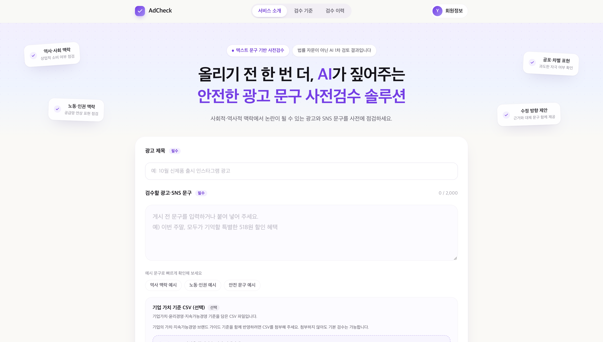
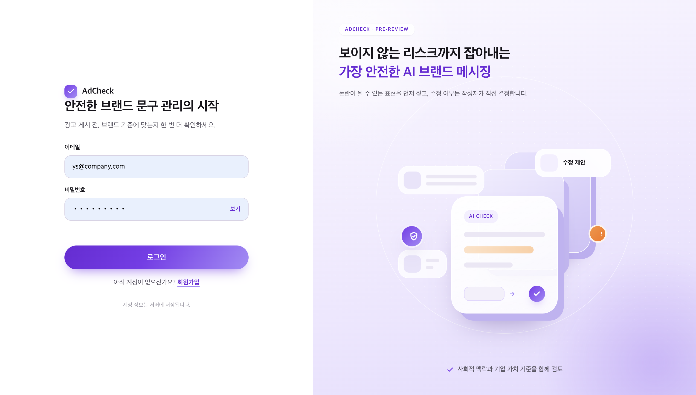
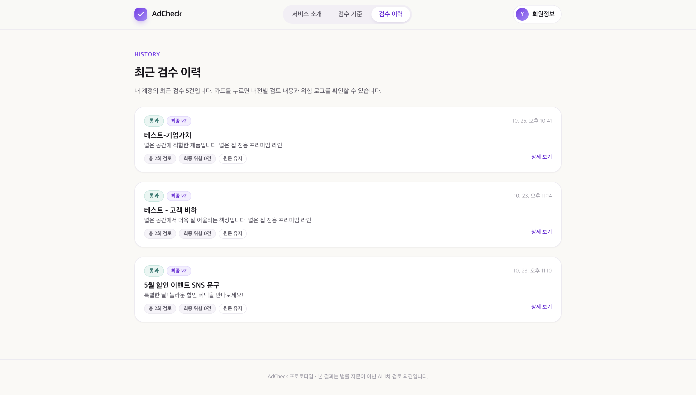
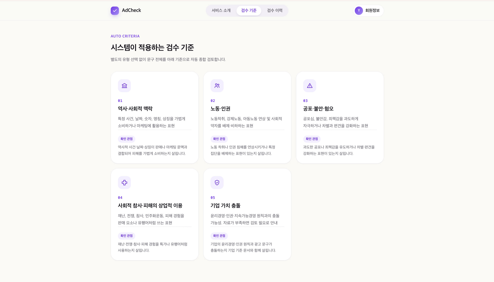

# [AdCheck] 광고 문구 사전 검수 AI

**SNS 광고 문구를 올리기 전에, 사회·역사적 논란과 기업 가치 충돌 가능성을 AI가 먼저 검수합니다.**

담당자가 광고 문구를 입력하면 AdCheck는

1. 문제가 될 수 있는 **표현을 원문에서 짚고**,
2. 왜 위험한지 **근거 문서(사회 기준·실제 논란 사례·기업 가치 문서)와 함께 설명**하고,
3. 바로 바꿔 쓸 수 있는 **수정안**을 제안합니다.

| 입력 문구 | AdCheck 결과 |
| --- | --- |
| `5·18 탱크데이! 책상에 탁 치면 억 소리 나는 할인` | **수정 권고** · 5·18 민주화운동과 박종철 사건을 연상시키는 표현<br>근거: 실제 광고 논란 보도 · 수정안: `특별한 할인! 놀라운 혜택을 만나보세요` |
| `이 제품을 안 쓰면 정상적인 사람이 아닙니다` | **수정 권고** · 금기어 사전에 등록된 차별 표현 |
| `가을맞이 원목 책장 10% 할인, 조립 서비스 무료` | **통과** |

> AdCheck의 판정은 게시 승인이나 법률 판단이 아닙니다. 사람이 최종 검토할 때 참고하는 1차 의견입니다.

<p align="center">
  
</p>

<br>

## 📍 왜 필요한가

SNS 광고 문구 하나가 브랜드 전체를 흔드는 시대입니다.
무심코 쓴 단어가 **역사적 사건이나 사회적 아픔**을 떠올리게 하거나, 회사가 지켜 온 **기업 가치와 어긋나면** 논란은 순식간에 퍼집니다.
하지만 게시 전에 이런 맥락을 사람이 매번 빠짐없이 확인하기는 어렵습니다.

AdCheck는 이 확인을 돕습니다.

- **근거 있는 판단**: 사회·역사 기준 문서, 실제 논란 사례, 회사가 올린 기업 가치 문서에서 근거를 찾아 판단합니다. 근거 없이 위험하다고 단정하지 않습니다.
- **기업마다 다른 기준**: 회사가 기업 가치·윤리경영 문서(CSV)를 올리면 그 회사의 검수에만 근거로 씁니다.
- **모르면 사람에게**: 근거가 부족하거나 확신할 수 없으면 `검토 필요`로 담당자에게 넘깁니다.

<br>

## 📜 주요 기능

### 1. 회원가입 · 로그인
- 회사 단위로 계정을 만들고 로그인합니다. 기업 문서와 검수 이력은 회사 계정별로 관리됩니다.

<p align="center"></p>

### 2. 광고 문구 검수 요청
- 광고 제목과 검수할 문구를 입력합니다.
- 기업 가치·윤리경영·지속가능경영 기준을 담은 CSV를 선택해서 첨부할 수 있습니다.

- 위 메인 화면에서 바로 입력합니다. 예시 문구 버튼으로 빠르게 확인해 볼 수 있습니다.

### 3. 실시간 검수 진행 상황
- 금기어 탐지 → 근거 검색(사회 기준·기업 문서) → AI 판정 → 수정안 생성 → 결과 검증의 각 단계를 실시간(SSE)으로 보여 줍니다.
- 근거가 부족하면 최근 이슈를 외부 검색으로 보강한 뒤 다시 판정합니다.

<!-- TODO: 진행 상황 화면 캡처 -->

### 4. 검수 결과와 수정안
- 결과는 **통과**(`pass`), **수정 권고**(`revise`), **검토 필요**(`needs_review`) 세 가지입니다.
- 위험 표현마다 **금기어 / 의미 기반** 구분, 위험도, AI 검토 의견, **판단 근거**(사회 기준·기업 문서·외부 검색), **수정안**을 보여 줍니다.
- 수정안을 골라 적용하고, 문구를 직접 고친 뒤 **재검토**할 수 있습니다(v1 → v2).
- 원문에 없는 인용이나 검색되지 않은 근거는 검증 단계에서 걸러 냅니다.

<!-- TODO: 검수 결과 화면 캡처 -->

### 5. 검수 이력
- 최근 검수를 카드로 모아 보고, 버전별 검토 내용과 위험 로그를 다시 확인합니다.

<p align="center"></p>

### 6. 검수 기준 안내
- 시스템이 어떤 관점으로 문구를 검토하는지 안내합니다.

<p align="center"></p>

<br>

## 🧭 서비스 구조

```text
 사용자 ──▶ FE (Vue) ──JWT──▶ BE (Spring Boot) ──기업 문서 CSV 업로드──▶ rag-mcp
                 ▲                │
                 │ SSE(진행 상황)  │ 검수 요청 (202 Accepted)
                 │                ▼
                 │            ai-agent (LangGraph)
                 │              ├─ rag-mcp (MCP)      사회 기준·실제 사례·기업 문서 검색 (pgvector)
                 │              └─ business-mcp (MCP)  필요할 때만 외부 검색
                 │                │
                 └──── BE ◀───────┘ 단계별 체크포인트·최종 결과 저장 (business-mcp 경유)
```

**AI 검수 단계 (ai-agent)**

| 단계 | 하는 일 |
| --- | --- |
| 금기어 탐지 | 금기어 사전과 문구를 대조 (참고 신호로만 사용) |
| 근거 검색 | 사회·역사 기준과 실제 논란 사례, 첨부한 기업 문서를 검색 |
| AI 판정 | 근거와 연결되는 표현만 위험으로 지적, 근거가 부족하면 외부 검색 후 다시 판정 |
| 수정안 생성 | 문제 단어·장면을 뺀 수정안을 만들고, 적용한 문구를 다시 판정해 확인 |
| 결과 검증 | 원문에 없는 인용, 검색되지 않은 근거를 걸러 내고 불확실하면 `검토 필요`로 전환 |

| 저장소 | 설명 |
| --- | --- |
| [AdCheck-FE](https://github.com/AdCheck-Agent/AdCheck-FE) | Vue 3 + Vite 프론트엔드 |
| [AdCheck-BE](https://github.com/AdCheck-Agent/AdCheck-BE) | Spring Boot 백엔드 (인증, 검수 요청, SSE, 결과 저장·조회) |
| [AdCheck-AI-MCP](https://github.com/AdCheck-Agent/AdCheck-AI-MCP) | AI Agent(LangGraph)와 RAG·Business MCP 서버 |

<br>

## 🛠️ 기술 스택

**Frontend**<br>


**Backend**<br>


**AI · MCP**<br>


**Infra**<br>


<br>

## 👥 팀원 구성

| 역할 | 이름 | 담당 |
| --- | --- | --- |
| PM · PO | 김지영 | 전체 일정 관리, 발표·산출물 자료 제작 |
| AI · MCP | 신주윤 | AI Agent · 판정 (LangGraph 파이프라인, 금기어 탐지, LLM 판정·수정안·검증) |
| AI · MCP | 박영신 | 데이터 · 검색 · MCP (RAG, pgvector, 기업 문서 적재, 외부 검색) |
| Backend | 김태건 | 인증 · SSE · 결과 조회 · 서버 간 통신 |
| Backend | 윤서준 | 검수 시작 API · DB · 체크포인트 저장 |
| Frontend | 이정현 | 화면 · SSE 연결 · 결과 표시 |

<br>

## 📷 시연 영상

<!-- TODO: 시연 영상 링크 -->

<br>

## 💭 프로젝트 후기

<!-- TODO: 팀 후기 -->
